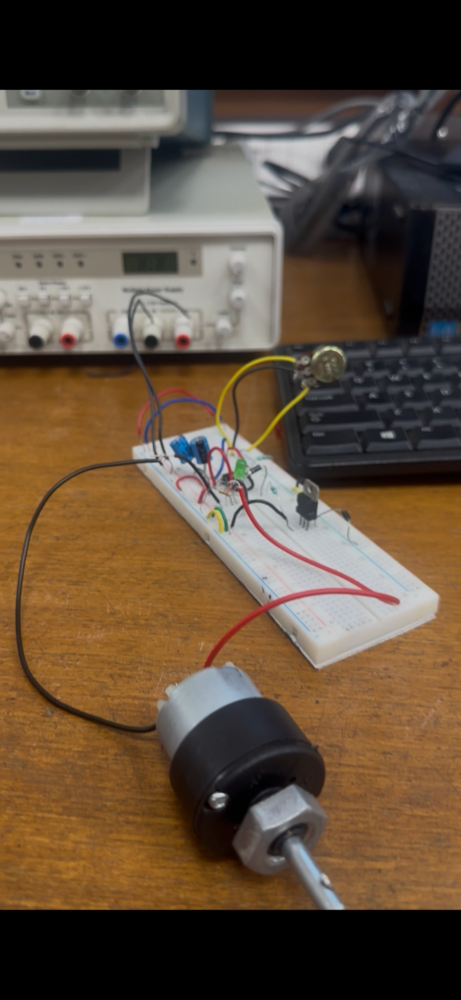
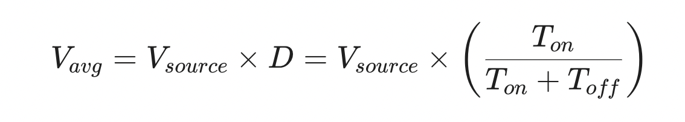
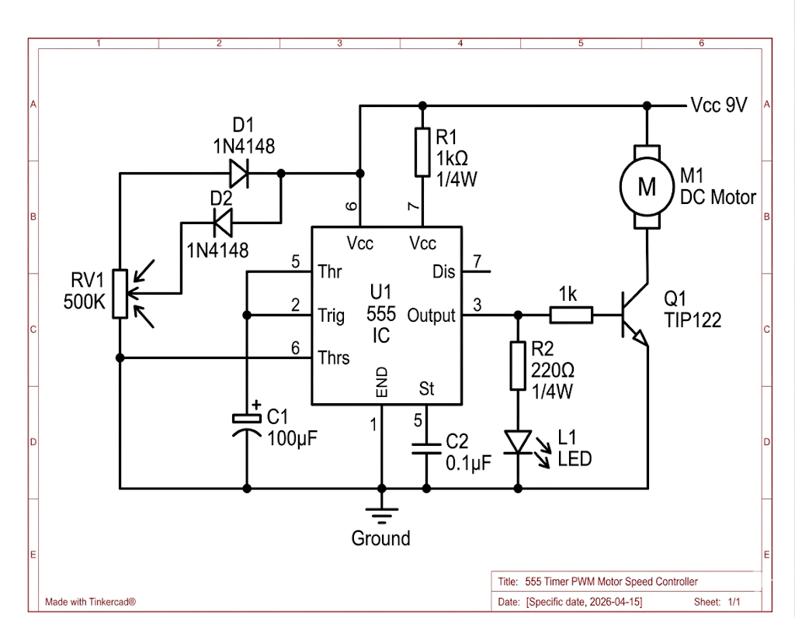

# PWM-Based Speed Control of a DC Motor using a 555 Timer

A hardware project that controls the speed of a permanent-magnet DC motor by varying the duty cycle of a PWM signal generated with an NE555 timer in astable mode, switched through a TIP122 Darlington transistor.

| | |
|---|---|
| **Course** | ELL-1000: Introduction to Electrical Engineering |
| **Institute** | Indian Institute of Technology Delhi |
| **Team** | Spraha Vats (2025CE12028), Veeraj Jain (2025CE11853) |
| **Type** | Hardware prototype (breadboard) |

## Demo



<!-- Add a demo video or GIF here once you have one:

-->

## Overview

Varying a motor's speed with a series resistor or linear regulator wastes power as heat. PWM avoids this by switching the motor fully on and off at high speed, so the average voltage depends on the duty cycle `D`:



The 555 timer produces the PWM signal. A potentiometer with two steering diodes gives the timing capacitor separate charge and discharge paths, so the duty cycle can be changed without changing the frequency much. The 555 cannot supply enough current for a motor, so its output drives a TIP122 Darlington transistor that switches the motor.

## Circuit Diagram



*Schematic drawn in Tinkercad.*

## How It Works

1. **Charging:** The 100 µF capacitor charges through one section of the 500 kΩ potentiometer and one diode until it reaches 2/3 Vcc, at which point the 555 output goes low.
2. **Discharging:** The capacitor then discharges through the other diode and the remaining section of the potentiometer until it falls to 1/3 Vcc, and the output goes high again.
3. **Speed control:** Turning the potentiometer changes the ratio of on-time to off-time, which changes the duty cycle and therefore the motor speed.
4. **Power stage:** The 555 output (pin 3) drives the base of the TIP122 through a 1 kΩ resistor. The transistor switches the motor to ground, and the motor's inertia smooths the pulses into steady rotation.
5. **Indicator:** An LED with a 220 Ω resistor on the output shows the duty cycle changing as the knob turns.

## Components

| Component | Purpose |
|---|---|
| NE555 timer IC | Generates the PWM signal (astable mode) |
| TIP122 NPN Darlington transistor | High-current switch for the motor |
| 500 kΩ potentiometer | Sets the duty cycle |
| 100 µF electrolytic capacitor | Timing capacitor |
| 0.1 µF capacitor | Decoupling on the control pin |
| 1N4148 / 1N4007 diodes | Steer charge and discharge current |
| 1 kΩ resistors | Base resistor for the TIP122, pull-up on the discharge pin |
| 220 Ω resistor + LED | Visual indicator |
| DC motor with propeller | Load |
| Breadboard, 9 V supply | Prototyping and power |

## Course Concepts Applied

- **Network analysis (Exp 2):** KVL and KCL for the timing network and power stage; Thevenin equivalent for the 555's internal voltage divider.
- **Filter characteristics (Exp 4):** The motor's inductance and mechanical inertia act like a low-pass filter on the PWM signal.
- **Non-linear electronics (Exp 5):** Diodes used for current steering and for flyback protection.
- **Transient analysis (Exp 6):** RC charge and discharge sets the switching thresholds and timing.
- **Integrated circuits (Exp 7):** The 555's internal comparators and flip-flop, as a practical extension of op-amp comparators.

## Advantages and Limitations

**Advantages:** high efficiency (little heat), full-voltage pulses so the motor keeps its torque at low speed, and low cost with no microcontroller.

**Limitations:** switching noise (EMI), open-loop control (speed drops under load), and possible stuttering if the switching frequency is too low.

## Possible Improvements

- Add a 1N4007 flyback diode across the motor to protect the TIP122 from inductive spikes.
- Add closed-loop control with a tachometer or optical encoder to hold RPM under load.
- Replace the 555 with a microcontroller for programmable speed profiles.
- Use an H-bridge to add direction control and braking.

## Full Report

The complete project report is in [`docs/ELL_Project_555_timer.pdf`](docs/ELL_Project_555_timer.pdf).

## Repository Structure

```
.
├── README.md
├── docs/
│   └── ELL_Project_555_timer.pdf
└── images/
    ├── breadboard.jpg
    ├── circuit-diagram.png
    └── formula.png
```

## References

1. A. S. Sedra and K. C. Smith, *Microelectronic Circuits*, Oxford University Press.
2. R. L. Boylestad, *Electronic Devices and Circuit Theory*, Pearson.
3. Texas Instruments, *NE555 Precision Timers* datasheet.
